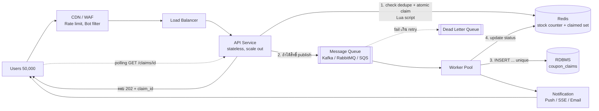

# PERSEC Technical System Analyst — AI Reference Answers

> เอกสารนี้สร้างโดย Claude AI เพื่อเป็นข้อมูลอ้างอิงเปรียบเทียบ ดูรายละเอียดที่หัวข้อ "AI Assistance Disclosure" ท้ายไฟล์

---

## Scenario 1 — Flash Sale

**โจทย์:** คูปอง 1,000 สิทธิ์, ผู้ใช้ 50,000 คน กดพร้อมกันใน 5 นาที

### หลักคิด

- 50,000 request / 300 วินาที ≈ เฉลี่ย 170 RPS แต่จริงจะกระจุกช่วงต้น (peak อาจหลายพัน RPS)
- ผู้ชนะมีแค่ 1,000 คน → **คน 98% ควรถูกปฏิเสธเร็วที่สุด ก่อนแตะ Database**
- ดังนั้นแยก "ตัดสินว่าได้สิทธิ์ไหม" (เร็ว, atomic) ออกจาก "บันทึกผลถาวร" (async)

### Architecture



### บทบาทแต่ละส่วน

| ส่วน | หน้าที่ |
|---|---|
| CDN/WAF/Rate limit | ตัด bot, จำกัด request ต่อ user/IP, ทำหน้า "รอคิว" แบบ static |
| API | Validate token, ตรวจสิทธิ์, เรียก Redis ตัดสินผลทันที, ตอบเร็ว (ไม่รอ DB) |
| Redis (Cache) | เก็บ stock counter และ set ของคนที่ claim แล้ว ตัดสินแบบ atomic ด้วย Lua script |
| Queue | รับ "ผู้ชนะ" เพื่อ buffer ให้ DB เขียนตามจังหวะที่รับไหว |
| Worker | consume แล้วเขียน DB (idempotent), ส่ง notification |
| Database | Source of truth ถาวร มี unique constraint เป็นด่านสุดท้าย |

### การป้องกัน Race Condition

ด่านที่ 1 – Redis Lua script (รันแบบ atomic ใน Redis ตัวเดียว):

```lua
-- KEYS[1]=coupon:stock  KEYS[2]=coupon:claimed (set)  ARGV[1]=user_id
if redis.call('SISMEMBER', KEYS[2], ARGV[1]) == 1 then return 2 end  -- เคยรับแล้ว
local stock = tonumber(redis.call('GET', KEYS[1]))
if stock <= 0 then return 0 end                                       -- หมด
redis.call('DECR', KEYS[1])
redis.call('SADD', KEYS[2], ARGV[1])
return 1                                                              -- ได้สิทธิ์
```

ด่านที่ 2 – DB: `UNIQUE (campaign_id, user_id)` กันซ้ำ และ `UNIQUE(claim_id)` กัน message ซ้ำ  
ด่านนี้ทำให้แม้ Redis พัง/ข้อมูลเพี้ยน สิทธิ์ก็ไม่เกินและไม่ซ้ำรายคน

### เมื่อ Worker ล่ม / Message ซ้ำ

- **ใช้ at-least-once + idempotent consumer**: Worker ack เมื่อเขียน DB สำเร็จเท่านั้น ถ้าล่มกลางทาง message กลับเข้าคิว
- Message มี `claim_id` (UUID สร้างที่ API) → `INSERT ... ON CONFLICT DO NOTHING` ประมวลผลซ้ำกี่ครั้งผลเท่าเดิม
- retry แบบ exponential backoff, เกินกำหนดเข้า DLQ แล้ว alert
- **Redis หายหลังตัดสิทธิ์แต่ก่อนลง DB**: ทำ reconcile job เทียบ `1000 - COUNT(DB)` กับ counter ใน Redis แล้วแก้; ใช้ Redis persistence (AOF) ลดความเสี่ยง
- ถ้า publish queue ไม่สำเร็จหลัง Redis ตัดสิทธิ์แล้ว → rollback (INCR + SREM) หรือใช้ outbox/retry

### การแจ้งผล

1. API ตอบทันที: `202 Accepted` + `claim_id` (หรือ `409/410` ถ้าหมด/รับแล้ว)
2. ผลสุดท้ายแจ้งผ่าน Polling `GET /claims/{id}` (ง่ายสุด), SSE/WebSocket, หรือ Push/Email
3. หน้า UI แสดงสถานะ "กำลังยืนยันสิทธิ์" → "สำเร็จ/ไม่สำเร็จ" ชัดเจน
4. คนที่หมดสิทธิ์ได้คำตอบทันที ไม่ต้องรอคิว

---

## Scenario 2 — Technical Mentoring

**โจทย์:** Junior ทำ Sales Report API ประเมิน 2 วัน ผ่านไป 4 วัน ยังไม่เสร็จ, API ค้างและเกิด HTTP 500 บางครั้ง, Junior เครียด

### 1. รับฟังและประเมิน (วันแรกคือเรื่องคน ก่อนเรื่องโค้ด)

- คุยแบบ 1:1 ไม่ใช้บรรยากาศ "สอบสวน" เริ่มจากถาม "ตอนนี้ติดอะไรอยู่ / อะไรที่กังวลที่สุด"
- แยกให้ออกว่าสาเหตุคือ: ประเมินพลาด / requirement ไม่ชัด / ติดเทคนิค / ไม่กล้าถาม
- ย้ำว่า estimate พลาดเป็นเรื่องปกติและเป็นความรับผิดชอบร่วมของทีม ไม่ใช่ความผิดของคนเดียว
- ขอให้เล่า "ลองอะไรไปแล้วบ้าง" เพื่อประเมินระดับทักษะ debug ของเขา

### 2. ตรวจสอบ Requirement

- Report ต้องการอะไร: ช่วงเวลาข้อมูล, ปริมาณ row, filter, ความถี่ใช้งาน, real-time หรือ snapshot?
- Scope creep หรือไม่: ขอเพิ่มระหว่างทาง? มี acceptance criteria เขียนไว้ไหม?
- ข้อมูลจริงใหญ่กว่าที่คิดไหม (ตอนประเมิน 2 วันอาจสมมติข้อมูลน้อย)
- ถ้า requirement ยังกำกวม ผม (SA) ไปคุยกับ PO/Business เอง เพื่อลดภาระ Junior

### 3. แนะนำ Debugging (สอนวิธี ไม่ใช่ให้คำตอบ)

อาการ "ค้าง + 500 เป็นบางครั้ง" ชี้ไปที่ปัญหาที่ขึ้นกับ **ข้อมูล/โหลด/ทรัพยากร** มากกว่าบั๊ก logic ตรงๆ:

1. **Reproduce**: หา pattern ว่า 500 เกิดตอน parameter/ช่วงวันที่/ปริมาณข้อมูลแบบไหน
2. **ดู log + stack trace** ของ request ที่พัง (ถ้ายังไม่มี log ให้เพิ่ม correlation id)
3. **แยกชั้น**: ช้าที่ query, ที่ application, หรือที่ serialize response?
4. **จุดที่พบบ่อยของ report API**:
   - Query ไม่มี index / full scan / `SELECT *`
   - N+1 query ใน loop
   - โหลดข้อมูลทั้งหมดเข้า memory แทน aggregate ที่ DB / ไม่มี pagination
   - Timeout ของ DB/HTTP, connection pool หมด, lock จาก transaction ยาว
   - Null/ข้อมูลผิดรูปบางแถวทำให้ exception เป็นบางครั้ง
5. ใช้ `EXPLAIN`, slow query log, profiler/APM ช่วยวัด ไม่ใช่เดา

### 4. ช่วยโดยไม่แย่งทำงาน

- ใช้ **pair debugging**: ให้ Junior เป็นคนจับ keyboard ผมถามนำ ("คิดว่า query นี้ทำงานกี่ครั้ง?")
- ให้ทางเลือกและเหตุผล แล้วให้เขาตัดสินใจเอง เป้าคือเขาแก้ได้และอธิบายได้
- แบ่งเป็นชิ้นเล็ก: (1) ทำให้ไม่ 500 ก่อน (2) ทำให้เร็วพอ (3) ค่อย polish
- ผมแตะโค้ดเองเฉพาะกรณี production กำลังได้รับผลกระทบ และจะอธิบายย้อนหลังให้เขาเสมอ
- ชมสิ่งที่ทำถูก และสรุปบทเรียนร่วมกัน (เช่น วิธี estimate / การถามเมื่อติด)

### 5. Deadline และการสื่อสารกับทีม

- ประเมินงานที่เหลือใหม่ร่วมกับ Junior (ให้เป็นช่วง เช่น 1–2 วัน พร้อมสมมติฐาน)
- แจ้ง PM/PO ล่วงหน้าด้วยข้อเท็จจริง: สถานะ, สาเหตุ, แผน, วันที่คาดว่าเสร็จใหม่ — ผมรับหน้าเสาในการสื่อสาร ไม่โยนให้ Junior
- ถ้า deadline ขยับไม่ได้: ลด scope (ส่ง report เวอร์ชันแรกที่ใช้งานได้ก่อน), หรือเพิ่มคน, ไม่ใช่เร่งให้ Junior อดนอน
- ตั้ง checkpoint สั้นๆ ทุกวัน (15 นาที) เพื่อเห็นปัญหาเร็วขึ้น ไม่รอจนเลยกำหนดอีก
- หลังจบ: retro แบบ blameless ว่าครั้งหน้าจะ estimate / ขอความช่วยเหลือเร็วขึ้นได้อย่างไร

---

## Scenario 3 — Coupon Overbooking

**โจทย์:** คูปอง 100 สิทธิ์, ผู้ใช้หลักหมื่นกดพร้อมกัน, ห้ามแจกเกิน

### Architecture

เหมือน Scenario 1 แต่ขนาดเล็กกว่า: API → (ตัวกรองหน้าด่านเช่น Redis) → Queue → Worker → DB  
ถ้าระบบเล็กหรืออยากเรียบง่าย **ใช้ DB อย่างเดียวด้วย atomic update ก็เพียงพอ** เพราะผู้ชนะมีแค่ 100 คน ส่วนที่เหลือถูกปฏิเสธด้วย query เบาๆ  
ความถูกต้องต้องอยู่ที่ **Database** เสมอ Redis/Queue เป็นแค่ตัวลดภาระ

### สาเหตุของ Overbooking (แบบที่ผิด)

```sql
-- ❌ check-then-act: สอง request อ่านเห็น remaining=1 พร้อมกัน แล้วต่างก็ลดและ insert
SELECT remaining FROM coupons WHERE id = 1;     -- 1
-- (app เช็คว่า > 0)
UPDATE coupons SET remaining = remaining - 1 WHERE id = 1;
INSERT INTO coupon_claims(...) ...;
```

### วิธีที่ถูก: Atomic Update + Unique Constraint + Idempotency ใน Transaction เดียว

Schema:

```sql
CREATE TABLE coupons (
  id         INT PRIMARY KEY,
  total      INT NOT NULL,
  remaining  INT NOT NULL CHECK (remaining >= 0)   -- กันติดลบอีกชั้น
);

CREATE TABLE coupon_claims (
  id             BIGINT PRIMARY KEY,
  coupon_id      INT  NOT NULL,
  user_id        BIGINT NOT NULL,
  idempotency_key UUID NOT NULL,
  created_at     TIMESTAMP NOT NULL DEFAULT now(),
  CONSTRAINT uq_one_per_user UNIQUE (coupon_id, user_id),   -- 1 คน 1 สิทธิ์
  CONSTRAINT uq_idem         UNIQUE (idempotency_key)       -- request/message ซ้ำ
);
```

Claim (PostgreSQL syntax):

```sql
BEGIN;

-- 1) ลง claim ก่อน: ถ้าซ้ำ (user เดิม/key เดิม) จะไม่ insert และไม่ตัด stock
INSERT INTO coupon_claims (id, coupon_id, user_id, idempotency_key)
VALUES (:id, 1, :user_id, :idem_key)
ON CONFLICT DO NOTHING;
-- ตรวจ rows affected: 0 = ซ้ำ → ROLLBACK แล้วตอบผลเดิม (idempotent)

-- 2) ตัด stock แบบ atomic: เงื่อนไขอยู่ใน UPDATE เดียว
UPDATE coupons
SET    remaining = remaining - 1
WHERE  id = 1 AND remaining > 0;
-- ตรวจ rows affected: 0 = หมดแล้ว → ROLLBACK (claim ใน step 1 ถูกยกเลิกด้วย)

COMMIT;
```

เหตุผล:

- `UPDATE ... WHERE remaining > 0` เป็นคำสั่งเดียว DB ล็อกแถวระหว่างทำ request ที่สองต้องรอแล้วเห็นค่าล่าสุด จึงลดได้เกิน 100 ครั้งไม่ได้ (ทั้ง READ COMMITTED และสูงกว่า)
- Transaction ทำให้ "บันทึก claim" กับ "ตัด stock" สำเร็จหรือล้มพร้อมกัน
- `UNIQUE (coupon_id, user_id)` กันผู้ใช้เดียวกดซ้ำ/รัวๆ แม้ผ่านหลาย server
- `CHECK (remaining >= 0)` เป็นตาข่ายสุดท้าย

ข้อควรระวัง: แถวเดียวที่ถูกแย่งกันหนักจะเป็น hot row (throughput จำกัด) แต่สำหรับ 100 สิทธิ์ยอมรับได้; ถ้ากังวล ให้ตัด request ส่วนเกินที่ Redis/Rate limit ก่อน หรือแตก stock เป็นหลาย bucket (กรณีสิทธิ์จำนวนมาก)

ทางเลือกอื่น: `SELECT ... FOR UPDATE` (pessimistic lock) ใช้ได้แต่ช้ากว่า atomic update; optimistic lock ด้วย `version` ใช้ได้แต่ retry เยอะเมื่อ contention สูง

### Idempotency

- Client/API สร้าง `idempotency_key` ต่อหนึ่งความพยายาม (หรือ derive จาก `coupon_id + user_id`)
- กดซ้ำ/retry/message ซ้ำ → ชน unique → ตอบ "ผลเดิม" (200 พร้อม claim เดิม) ไม่ใช่ error และไม่ตัด stock ซ้ำ

### กรณี Worker ล่ม

- Worker ack message หลัง `COMMIT` เท่านั้น
- ล่มก่อน commit → transaction rollback อัตโนมัติ, message ถูกส่งใหม่, ไม่มีผลค้าง
- ล่มหลัง commit แต่ก่อน ack → message ถูกส่งซ้ำ → ชน unique → ไม่ทำซ้ำ (idempotent)
- ใช้ DLQ สำหรับ message ที่ fail ซ้ำ และมี job ตรวจ `total - remaining = COUNT(claims)` เป็นระยะ

### Pseudocode ฝั่ง Worker

```python
def handle(msg):
    with db.transaction():
        inserted = db.exec("INSERT INTO coupon_claims ... ON CONFLICT DO NOTHING", msg)
        if inserted == 0:
            return ack(msg)                    # ซ้ำ: ถือว่าสำเร็จแล้ว
        updated = db.exec("UPDATE coupons SET remaining=remaining-1 "
                          "WHERE id=%s AND remaining>0", msg.coupon_id)
        if updated == 0:
            db.rollback()
            mark_result(msg, "SOLD_OUT")
            return ack(msg)
    mark_result(msg, "SUCCESS")
    ack(msg)
```

---

## Scenario 4 — API Key & Configuration

**โจทย์:** Developer เขียน API Key หรือ Third-Party URL ไว้ใน Source Code

### ผลกระทบ

**Security**
- Key หลุดผ่าน Git history, fork, log, CI artifact, ไฟล์ build/frontend bundle (แม้ลบออกภายหลัง history ก็ยังอยู่)
- ผู้ไม่หวังดีนำไปใช้ → ค่าใช้จ่ายพุ่ง, ข้อมูลรั่ว, ถูกใช้ในนามบริษัท
- ทุกคนที่เข้าถึง repo ได้ key เดียวกัน ตรวจสอบย้อนหลังไม่ได้ว่าใครใช้

**Maintainability**
- เปลี่ยน key/URL ต้อง build + deploy ใหม่ทุกครั้ง
- แยก Dev/UAT/Prod ไม่ได้โดยไม่แก้โค้ด หรือพลาดชี้ผิด environment
- Rotate key ยาก, ไม่มีทางเปลี่ยนเร่งด่วนระหว่าง incident

### Configuration vs Secret

| | Configuration | Secret |
|---|---|---|
| ตัวอย่าง | Base URL, timeout, feature flag, log level | API key, DB password, token, private key |
| ความลับ | ไม่ลับ (เปิดเผยได้) | ลับ ห้ามเปิดเผย |
| ที่เก็บ | env var, config file, ConfigMap | Secret Manager / Vault / K8s Secret (encrypted) |
| ใน Git | เก็บ default/ตัวอย่างได้ | **ห้าม** (เก็บแค่ `.env.example` ไม่มีค่าจริง) |
| Audit | ไม่จำเป็นมาก | ต้องมี access log + rotation |

หมายเหตุ: Third-party URL เป็น config (ควรแยกออกจากโค้ด) แต่ถ้า URL มี token/credential ฝังอยู่ ให้ถือเป็น secret

### แนวทางจัดเก็บ

1. **Environment Variables**: ง่าย เหมาะ 12-factor อ่านจาก `os.environ` ตอนเริ่มระบบ และ fail fast ถ้าไม่มีค่า ข้อเสีย: อาจโผล่ใน process dump/log ถ้าไม่ระวัง
2. **Secret Manager** (AWS Secrets Manager, GCP Secret Manager, Azure Key Vault, HashiCorp Vault): เข้ารหัส, คุมสิทธิ์ราย service (IAM), มี audit log, รองรับ rotation อัตโนมัติ เหมาะกับ production
3. **CI/CD**: เก็บเป็น encrypted secrets ของ pipeline ไม่พิมพ์ใน log
4. ใช้ key แยกรายสภาพแวดล้อม และให้สิทธิ์น้อยที่สุด (least privilege / scope จำกัด)

```python
# ตัวอย่าง
API_URL = os.environ["PAYMENT_API_URL"]          # config
API_KEY = secret_manager.get("payment/api-key")   # secret
```

### เมื่อ Key รั่ว (Incident Response)

1. **Revoke/Rotate ทันที** (อย่ารอลบจาก repo ก่อน) ออก key ใหม่และ deploy
2. ตรวจ usage log ของผู้ให้บริการ ว่ามีการใช้ผิดปกติ/ช่วงเวลาไหน ประเมินความเสียหาย
3. ลบออกจากโค้ด และถ้าจำเป็นล้าง history (`git filter-repo`/BFG) — แต่ถือว่า key นั้น "ตายแล้ว" ไม่ว่าจะล้างหรือไม่
4. แจ้ง Security/ผู้เกี่ยวข้อง (และลูกค้าถ้าข้อมูลได้รับผลกระทบ)
5. ทำ post-mortem แบบ blameless: รั่วทางไหน ทำไมระบบไม่จับได้

### ป้องกันในอนาคต

- **Secret scanning**: pre-commit hook (gitleaks, detect-secrets) + CI scan + GitHub secret scanning/push protection
- **Code review checklist**: ตรวจ hardcode key/URL ทุก PR
- `.gitignore` สำหรับ `.env`, มี `.env.example` เป็นแม่แบบ
- ตั้ง rotation policy และอายุ key สั้น
- Least privilege + แยก key ตาม environment/service
- อบรมทีม และมี standard การจัดการ config/secret ใน coding guideline
- ฝั่ง frontend: ห้ามใส่ secret ใน client code — เรียกผ่าน backend proxy

---

## AI Assistance Disclosure

เนื้อหาในไฟล์ `claude-answer.md` นี้เป็นคำตอบที่**สร้างโดย Claude AI (Anthropic)** เพื่อใช้เป็นข้อมูลอ้างอิงและเปรียบเทียบกับคำตอบของผู้สมัครใน `README.md` เท่านั้น **ไม่ใช่คำตอบที่ผู้สมัครเขียนเอง** และไม่ได้เลียนแบบหรือแก้ไขคำตอบของผู้สมัคร

### Prompt ที่ใช้

````text
ช่วยจัดทำคำตอบ Pre-Interview ตำแหน่ง Technical System Analyst ของ PERSEC โดยทำงานใน Repository ปัจจุบัน
กฎสำคัญ

1. ห้ามแก้ไข README.md เด็ดขาด เพราะเป็นพื้นที่สำหรับคำตอบและมุมมองของผมเอง
2. สร้างไฟล์ `claude-answer.md` เพียงไฟล์เดียว
3. รวมคำตอบทั้ง 4 สถานการณ์ไว้ในไฟล์เดียว ไม่ต้องแยกไฟล์ตามข้อ
4. ห้ามสร้างหรือแก้ไขไฟล์อื่น รวมถึง `prompts.md`
5. ห้าม Commit หรือ Push ขึ้น GitHub
6. ไม่ต้องแก้ไขหรือปรับปรุงคำตอบของผมใน README.md
7. หากต้องอ่าน README.md เพื่อดูบริบท สามารถอ่านได้ แต่ห้ามเปลี่ยนแปลง

เป้าหมาย
ผมต้องการให้คุณ (Claude) เสนอคำตอบในมุมมองของ AI เพื่อใช้เปรียบเทียบกับแนวคิดที่ผมตอบเอง
ไม่ต้องพยายามเลียนแบบคำตอบของผม และไม่ต้องเขียนเหมือนผมเป็นคนตอบ
ให้ตอบตามความเข้าใจทาง Technical ของคุณเอง แต่ใช้ภาษาไทยที่ Developer อ่านเข้าใจง่าย ไม่ยาวเกินความจำเป็น
สถานการณ์ที่ 1 — Flash Sale
มีคูปอง 1,000 สิทธิ์ และผู้ใช้ 50,000 คนเข้ามากดรับพร้อมกันภายใน 5 นาที
อธิบาย:

* High-Level System Architecture
* การจัดการ Traffic
* บทบาทของ API, Queue, Worker, Database และ Cache (ถ้าจำเป็น)
* วิธีป้องกัน Race Condition
* วิธีจัดการเมื่อ Worker ล่มหรือ Message ถูกประมวลผลซ้ำ
* วิธีแจ้งผลกลับผู้ใช้

สร้าง Mermaid Architecture Diagram ประกอบ
สถานการณ์ที่ 2 — Technical Mentoring
Junior Developer ได้รับงาน Sales Report API ประเมินไว้ 2 วัน แต่ผ่านไป 4 วันยังไม่เสร็จ API ค้างและเกิด HTTP 500 เป็นบางครั้ง และ Junior มีความเครียด
อธิบายว่าคุณจะช่วยอย่างไรในฐานะ Technical SA โดยเน้น:

* การรับฟังและประเมินปัญหา
* การตรวจสอบ Requirement
* การแนะนำ Debugging
* การช่วย Junior โดยไม่แย่งทำงาน
* การจัดการ Deadline และการสื่อสารกับทีม

สถานการณ์ที่ 3 — Coupon Overbooking
มีคูปอง 100 สิทธิ์ และผู้ใช้หลักหมื่นคนกดรับพร้อมกัน
อธิบาย:

* Architecture ที่เหมาะสม
* วิธีป้องกันแจกสิทธิ์เกินจำนวน
* Database Transaction
* Atomic Update
* Unique Constraint
* Idempotency
* การจัดการกรณี Worker ล่ม

ยกตัวอย่าง SQL หรือ Pseudocode ที่ถูกต้องและอธิบายได้จริง
สถานการณ์ที่ 4 — Hardcoded API Key / URL
Developer เขียน API Key หรือ Third-Party URL ไว้ใน Source Code
อธิบาย:

* ผลกระทบด้าน Security และ Maintainability
* ความแตกต่างระหว่าง Configuration กับ Secret
* แนวทางจัดเก็บ API Key
* การใช้ Environment Variables หรือ Secret Manager
* วิธีจัดการหาก Key รั่ว
* แนวทางป้องกันปัญหาในอนาคต

รูปแบบผลลัพธ์
สร้างไฟล์เดียวชื่อ `claude-answer.md` โดยใช้หัวข้อ:
PERSEC Technical System Analyst — AI Reference Answers
Scenario 1 — Flash Sale
Scenario 2 — Technical Mentoring
Scenario 3 — Coupon Overbooking
Scenario 4 — API Key & Configuration
ใช้ภาษาไทย กระชับ มี Diagram หรือ Code เฉพาะที่จำเป็น
ท้ายไฟล์เพิ่มหัวข้อ:
AI Assistance Disclosure
ระบุอย่างชัดเจนว่าเนื้อหาในไฟล์นี้เป็นคำตอบที่สร้างโดย Claude AI เพื่อใช้เป็นข้อมูลอ้างอิงและเปรียบเทียบกับคำตอบของผู้สมัครใน README.md ไม่ใช่คำตอบที่ผู้สมัครเขียนเอง
ให้บันทึก Prompt ฉบับนี้ไว้ท้ายไฟล์ด้วย เพื่อแสดงการใช้ AI อย่างโปร่งใสตามข้อกำหนดของโจทย์
เมื่อทำเสร็จ ตรวจสอบว่า Git Diff มีเพียงไฟล์ `claude-answer.md` ที่สร้างขึ้นใหม่ และ README.md ไม่ถูกแก้ไข
ห้าม Commit และห้าม Push
````
